# Katalog 24 postingan Instagram @tahurabootsco

Analisis per foto dari grid profil Instagram, satu entri per postingan.
Foto di `tiles/` adalah **foto asli akun tersebut**, dipotong satu per satu
dari tangkapan layar grid profil (bukan hasil generate).

> **Batas metode.** Sandbox ini tidak bisa membuka instagram.com (koneksi
> ditolak), jadi foto tidak bisa diunduh langsung dari server Instagram dan
> caption tiap postingan tidak bisa dipasangkan otomatis. Yang tersedia di
> sini: potongan asli resolusi grid (381 x 507 px) + pembacaan visual detail.
> Untuk file resolusi penuh dan caption asli per postingan, lihat bagian
> *Yang perlu kamu tambahkan* di akhir dokumen.

> **Cakupan.** Dua tangkapan layar menampilkan 4 baris grid masing-masing
> (12 + 12 ubin). Tab bar Instagram bersifat *sticky*, jadi tidak bisa
> dipastikan kedua tangkapan layar bersambung tanpa celah. Kalau ada baris
> yang terlewat di antaranya, total pasang sepatu akan lebih besar dari 25.
> Tidak ada foto kembar di 24 ubin ini (sudah dicek dengan perceptual hash).

## Ringkasan

- Postingan dianalisis: **24**
- Foto studio (sepasang sepatu): **23**
- Foto lifestyle berisi 2 pasang: **2** pasang
- **Total pasang sepatu: 25**
- **Total sepatu (kiri + kanan): 50**

### Sebaran keluarga model

| Keluarga | Jumlah | Kode |
|---|---|---|
| Service & hiking lace-up | 5 | TB-02, TB-08, TB-20, TB-21, TB-22 |
| Chukka & derby | 5 | TB-04, TB-10, TB-11, TB-15, TB-16 |
| Strap & jodhpur ankle | 3 | TB-06, TB-09, TB-17 |
| Chelsea | 2 | TB-01, TB-03 |
| Mountain / alpine | 2 | TB-05, TB-23 |
| Canvas & wedge | 2 | TB-07, TB-12 |
| Western | 2 | TB-14, TB-19 |
| Engineer | 2 | TB-18, TB-24 |
| Lifestyle | 1 | TB-13 |

### Sebaran warna

Dihitung dari penilaian visual tiap foto; satu item bisa masuk lebih dari
satu keluarga kalau memang dua warna (mis. two-tone).

| Keluarga warna | Jumlah | Kode |
|---|---|---|
| Cokelat / cognac | 8 | TB-01, TB-04, TB-07, TB-09, TB-12, TB-13, TB-14, TB-22 |
| Taupe / abu | 5 | TB-02, TB-10, TB-11, TB-16, TB-21 |
| Hitam | 5 | TB-03, TB-06, TB-18, TB-19, TB-24 |
| Olive / hijau | 3 | TB-08, TB-20, TB-21 |
| Burgundy / oxblood | 3 | TB-13, TB-17, TB-23 |
| Tan / kuning | 3 | TB-05, TB-14, TB-15 |

---

## Analisis satu per satu

### TB-01 — Chelsea Pull-Up Cognac

[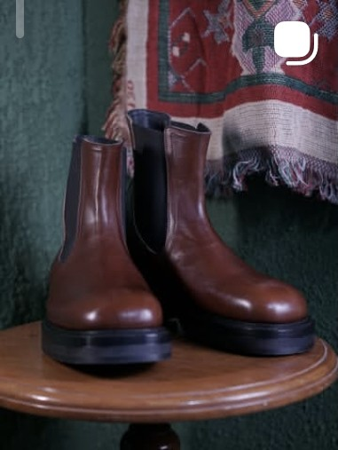](tiles/P01_s1r1c1.jpg)

- **Keluarga:** Chelsea
- **Arketipe:** Chelsea
- **Tinggi shaft:** 5,5 inci (pergelangan)
- **Bahan (visual):** Sapi pull-up halus, kilap sedang, warna cokelat karamel dengan gradasi lebih gelap di bagian tekuk
- **Warna:** Cognac / cokelat kayu manis
- **Sol:** Sol karet hitam berprofil tebal (cup sole) dengan tepi membulat
- **Konstruksi (terlihat):** Jahitan welt tidak menonjol; tampak konstruksi welt datar dengan midsole karet
- **Detail:** Elastis samping (gore) lebar khas Chelsea; Toe bulat (round toe), tanpa toe cap; Tanpa tali, tanpa resleting; Sol dan welt berwarna hitam, kontras dengan upper
- **Estimasi harga katalog (demo):** Rp 2.450.000
- **Tag:** chelsea, pull-up, round-toe, karet
- **Catatan komersial:** Sepatu harian paling aman untuk pasar luas; cocok untuk katalog entry-level.

### TB-02 — Lace-Up Shrunken Waxed Flesh

[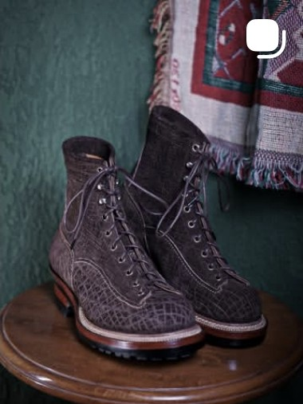](tiles/P02_s1r1c2.jpg)

- **Keluarga:** Service & hiking lace-up
- **Arketipe:** Tall lace-up (monkey/work)
- **Tinggi shaft:** 7 inci
- **Bahan (visual):** Kulit sapi bertekstur retak/keriput (shrunken atau waxed flesh) warna abu-cokelat
- **Warna:** Taupe gelap / cocoa abu
- **Sol:** Outsole karet hitam ber-tread dengan blok tumit; welt kulit cokelat dengan dua baris jahitan
- **Konstruksi (terlihat):** Welt kulit terlihat menonjol dengan jahitan ganda - ciri welt konstruksi tangan
- **Detail:** 12+ lubang tali (eyelets) sampai pergelangan; Toe bulat dengan sedikit toe bump; Panel samping satu potong, jahitan punggung di belakang; Tepi sol diberi wax/edge dressing cokelat
- **Estimasi harga katalog (demo):** Rp 3.350.000
- **Tag:** lace-up, waxed-flesh, workwear, welt-kulit
- **Catatan komersial:** Silhouette workwear yang sedang naik; kuat untuk konten 'patina progression'.

### TB-03 — Chelsea Commando Black

[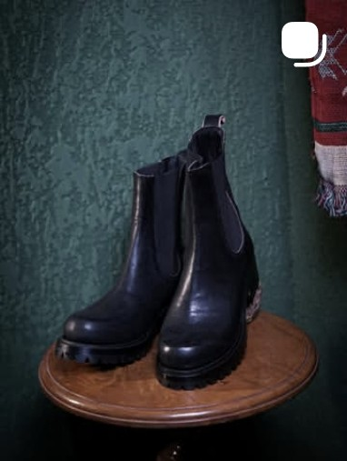](tiles/P03_s1r1c3.jpg)

- **Keluarga:** Chelsea
- **Arketipe:** Chelsea
- **Tinggi shaft:** 6 inci
- **Bahan (visual):** Sapi halus warna hitam, kilap rendah, sedikit crease di punggung kaki
- **Warna:** Hitam
- **Sol:** Outsole karet hitam bergerigi (commando) dengan tumit terpisah
- **Konstruksi (terlihat):** Welt datar; tepi sol gelap menyatu dengan upper
- **Detail:** Elastis samping sempit dan tinggi; Pull tab kecil di belakang; Toe bulat agak ringan (almond); Sol jauh lebih chunky dibanding TB-01
- **Estimasi harga katalog (demo):** Rp 2.650.000
- **Tag:** chelsea, commando, hitam, chunky
- **Catatan komersial:** Versi 'tough' dari Chelsea - laku untuk segmen musisi/kota.

### TB-04 — Chukka Crackled Dark Brown

[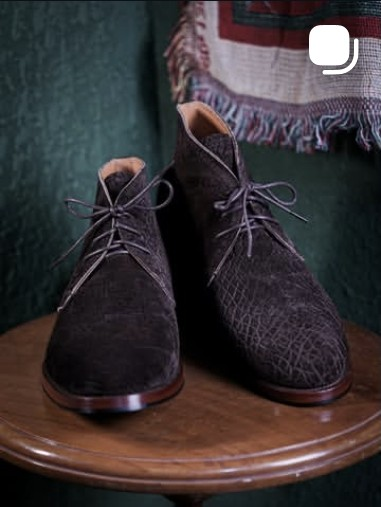](tiles/P04_s1r2c1.jpg)

- **Keluarga:** Chukka & derby
- **Arketipe:** Chukka
- **Tinggi shaft:** 4,5 inci
- **Bahan (visual):** Kulit bertekstur retak halus (crackled / shrunken grain), cokelat tua kehitaman
- **Warna:** Espresso
- **Sol:** Sol kulit tipis dengan tumit kecil bertumpuk; tanpa profil karet
- **Konstruksi (terlihat):** Welt datar tipis, jahitan rapat di sekeliling sol
- **Detail:** 3-4 pasang lubang tali; Tanpa toe cap, potongan derby terbuka; Lining terang (tan) terlihat di mulut sepatu; Silhouette ramping, cocok formal-kasual
- **Estimasi harga katalog (demo):** Rp 2.300.000
- **Tag:** chukka, crackled, kulit-sole, formal
- **Catatan komersial:** Produk 'smart casual' - titik masuk untuk pembeli pertama.

### TB-05 — Mountain Boot Two-Tone Tan

[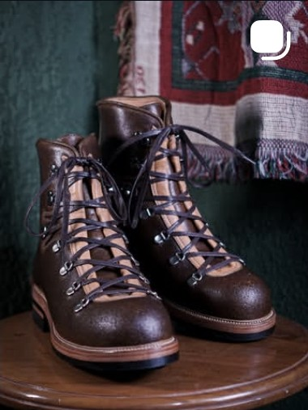](tiles/P05_s1r2c2.jpg)

- **Keluarga:** Mountain / alpine
- **Arketipe:** Mountain / alpine
- **Tinggi shaft:** 6,5 inci
- **Bahan (visual):** Dua bahan: kulit sapi cokelat di vamp/toe dan suede tan di shaft serta collar empuk
- **Warna:** Cokelat tua + tan
- **Sol:** Outsole karet hitam bergerigi dalam (logger/commando) dengan welt kulit tebal
- **Konstruksi (terlihat):** Welt kulit dengan jahitan ganda; tepi midsole menonjol khas sepatu gunung
- **Detail:** Hardware D-ring dan speed hook; Collar empuk (padded) warna tan; Toe cap halus dengan jahitan melintang; Tali kulit tebal warna cokelat
- **Estimasi harga katalog (demo):** Rp 3.850.000
- **Tag:** mountain, two-tone, suede, d-ring, commando
- **Catatan komersial:** Statement piece - visual paling 'outdoor premium' di grid.

### TB-06 — Strap Ankle Boot Black Brass

[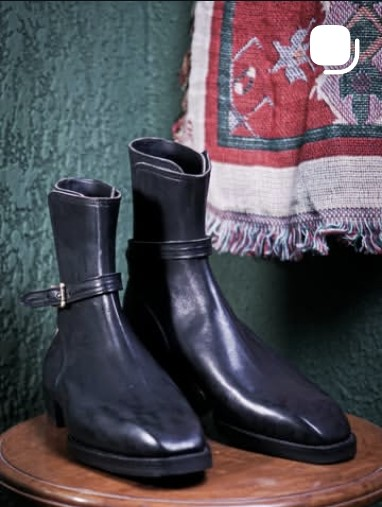](tiles/P06_s1r2c3.jpg)

- **Keluarga:** Strap & jodhpur ankle
- **Arketipe:** Strap / jodhpur ankle
- **Tinggi shaft:** 6 inci
- **Bahan (visual):** Sapi halus warna hitam, kilap sedang, crease halus di punggung kaki
- **Warna:** Hitam
- **Sol:** Sol karet hitam tipis dengan tepi rata, tanpa tumit tinggi
- **Konstruksi (terlihat):** Welt datar; jahitan sol nyaris tidak terlihat
- **Detail:** Satu strap pergelangan dengan buckle kuningan; Toe almond memanjang; Tanpa tali, tanpa elastis; Shaft lurus dengan top line terbuka
- **Estimasi harga katalog (demo):** Rp 2.750.000
- **Tag:** strap, buckle, almond-toe, hitam
- **Catatan komersial:** Silhouette fashion-forward; cocok untuk kampanye 'boots that dress up'.

### TB-07 — Tall Canvas-Shaft Lace Boot

[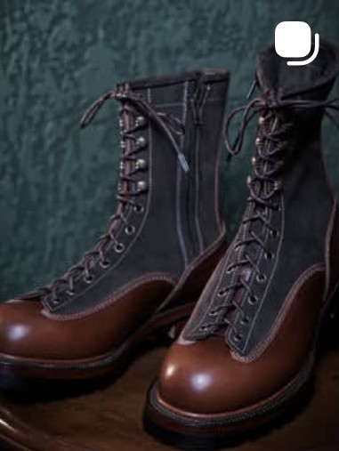](tiles/P07_s1r3c1.jpg)

- **Keluarga:** Canvas & wedge
- **Arketipe:** Tall lace-up (canvas shaft)
- **Tinggi shaft:** 8,5-9 inci
- **Bahan (visual):** Kulit cokelat di vamp dan toe; shaft dari kanvas/twill abu gelap dengan pipa kulit
- **Warna:** Cokelat + abu arang
- **Sol:** Wedge karet hitam rata dengan tepi kulit cokelat
- **Konstruksi (terlihat):** Welt datar; jahitan tepi sol terlihat rapi satu baris
- **Detail:** Tali dari kaki sampai atas shaft; Resleting di punggung untuk masuk-keluar; Toe cap kulit dengan jahitan melintang; Kontras bahan kulit vs tekstil
- **Estimasi harga katalog (demo):** Rp 3.150.000
- **Tag:** tall, canvas, zipper, wedge
- **Catatan komersial:** Paling 'editorial' dari semua item; bagus untuk reels styling.

### TB-08 — Service Boot Plain Toe Olive Brown

[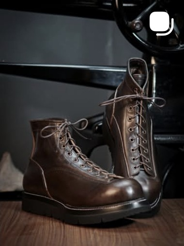](tiles/P08_s1r3c2.jpg)

- **Keluarga:** Service & hiking lace-up
- **Arketipe:** Service boot
- **Tinggi shaft:** 5,5 inci
- **Bahan (visual):** Sapi halus berwarna cokelat zaitun dengan patina terang di toe
- **Warna:** Olive brown
- **Sol:** Outsole karet hitam bergerigi dengan tumit rendah
- **Konstruksi (terlihat):** Welt datar dengan jahitan tepi ganda tipis
- **Detail:** 8 pasang lubang tali; Tanpa toe cap (plain toe); Jahitan counter tumit melintang; Tali kulit tipis warna senada
- **Estimasi harga katalog (demo):** Rp 2.950.000
- **Tag:** service-boot, plain-toe, olive, harian
- **Catatan komersial:** Rotasi harian pria kantor-kreatif; paling mudah dijual ulang.

### TB-09 — Buckled Gaucho Ankle Cognac

[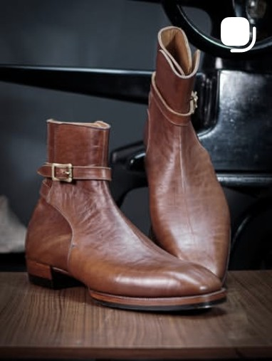](tiles/P09_s1r3c3.jpg)

- **Keluarga:** Strap & jodhpur ankle
- **Arketipe:** Strap / gaucho ankle
- **Tinggi shaft:** 7 inci
- **Bahan (visual):** Kulit sapi pull-up cognac dengan glaze tinggi dan grain terlihat
- **Warna:** Cognac / tan
- **Sol:** Sol kulit dengan tumit bertumpuk (stacked heel), tepi sol dipoles
- **Konstruksi (terlihat):** Welt datar tipis khas sepatu formal
- **Detail:** Satu strap dengan buckle kuningan; Mulut shaft terbuka dengan lining terang; Toe almond memanjang, siluet 70-an; Tanpa tali
- **Estimasi harga katalog (demo):** Rp 3.050.000
- **Tag:** gaucho, buckle, stacked-heel, cognac
- **Catatan komersial:** Produk niche dengan daya tarik fashion kuat; cocok untuk foto editorial.

### TB-10 — Chukka Grey Melange Suede

[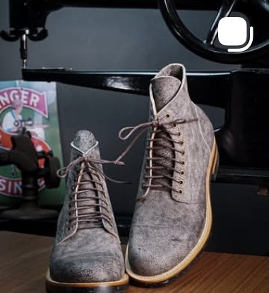](tiles/P10_s1r4c1.jpg)

- **Keluarga:** Chukka & derby
- **Arketipe:** Chukka
- **Tinggi shaft:** 4 inci
- **Bahan (visual):** Suede/nubuck abu dengan serat 'shrunken' dan warna tidak rata (melange)
- **Warna:** Abu terang
- **Sol:** Sol kulit natural/krem tipis dengan outsole gelap
- **Konstruksi (terlihat):** Welt datar tipis, jahitan halus
- **Detail:** 4 pasang lubang tali; Tanpa toe cap; Profil rendah dan ringan; Grain keriput - ciri leather shrunken
- **Estimasi harga katalog (demo):** Rp 2.250.000
- **Tag:** chukka, suede, abu, kulit-sole
- **Catatan komersial:** Summer/spring look; harga bahan lebih murah, margin lebih baik.

### TB-11 — Lace-Up Derby Grey Speckled

[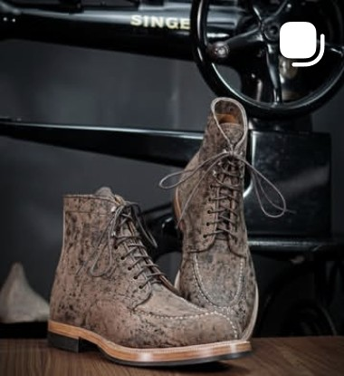](tiles/P11_s1r4c2.jpg)

- **Keluarga:** Chukka & derby
- **Arketipe:** Derby / lace-up rendah
- **Tinggi shaft:** 5 inci
- **Bahan (visual):** Kulit sapi tekstur marmer/berbintik (shrunken grain) abu-cokelat pucat
- **Warna:** Taupe kelabu bertotol
- **Sol:** Midsole kulit natural + outsole karet gelap tipis, tumit blok rendah
- **Konstruksi (terlihat):** Welt kulit dengan jahitan kontras putih di sepanjang tepi
- **Detail:** Enam pasang lubang tali, model derby terbuka; Jahitan dekoratif putih mengikuti panel toe; Toe bulat dengan sedikit bumper; Tepi midsole pucat - kontras paling terang di grid
- **Estimasi harga katalog (demo):** Rp 2.750.000
- **Tag:** derby, shrunken-grain, jahitan-kontras, kulit-sole
- **Catatan komersial:** Item paling 'collector' karena tekstur kulitnya; bagus untuk konten close-up grain.

### TB-12 — Two-Tone Wedge Embossed

[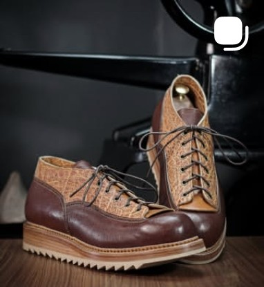](tiles/P12_s1r4c3.jpg)

- **Keluarga:** Canvas & wedge
- **Arketipe:** Wedge / work-oxy
- **Tinggi shaft:** 4,5 inci
- **Bahan (visual):** Dua bahan: kulit sapi cokelat tua di vamp dan heel, serta kulit emboss bergambar (motif burung/daun) di shaft
- **Warna:** Cokelat tua + tan emboss
- **Sol:** Wedge kulit tebal dengan gigi-gigi di tepi (outsole karet bergerigi)
- **Konstruksi (terlihat):** Jahitan tepi sol kontras dan jahitan dekoratif di panel
- **Detail:** Motif emboss dekoratif di panel atas; Toe bulat dengan bumper kulit; Sol wedge dua lapis dengan tepi bergerigi; Lining terang terlihat di mulut
- **Estimasi harga katalog (demo):** Rp 3.450.000
- **Tag:** wedge, two-tone, emboss, custom
- **Catatan komersial:** Paling custom dari seri studio; bagus untuk menonjolkan layanan MTO.

### TB-13 — Chelsea di Alam (foto lifestyle)

[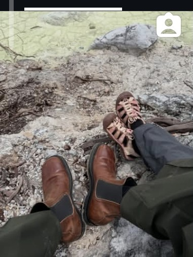](tiles/P13_s2r1c1.jpg)

- **Keluarga:** Lifestyle
- **Arketipe:** Lifestyle / Chelsea + sandal
- **Tinggi shaft:** 5,5 inci (Chelsea)
- **Bahan (visual):** Chelsea pull-up cokelat (mirip TB-01); sandal kulit burgundy dengan tali anyaman
- **Warna:** Cognac + burgundy
- **Sol:** Chelsea bersol karet gelap; sandal bersol tipis
- **Konstruksi (terlihat):** Tidak terlihat detail - foto dari jauh
- **Detail:** Dua orang: satu memakai Chelsea, satu memakai sandal kulit; Latar batu vulkanik hijau - konten outdoor; Sepatu terlihat sudah dipakai (ada crease dan debu); Satu-satunya foto non-studio di grid
- **Status:** konten lifestyle, tidak dijual
- **Tag:** lifestyle, outdoor, chelsea, sandal
- **Catatan komersial:** Bukti 'real world wear' - wajib dipakai di halaman testimoni.

### TB-14 — Western Boot Eagle Stitch Tan

[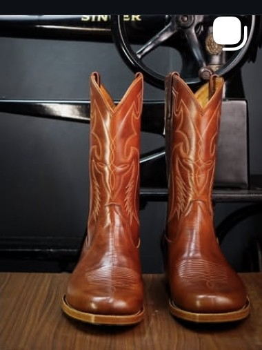](tiles/P14_s2r1c2.jpg)

- **Keluarga:** Western
- **Arketipe:** Western
- **Tinggi shaft:** 11 inci (shaft tinggi)
- **Bahan (visual):** Sapi oiled tan-oranye dengan kilap hangat
- **Warna:** Tan / oranye tembakau
- **Sol:** Sol kulit dengan tumit cuban bertumpuk
- **Konstruksi (terlihat):** Welt datar; shaft dijahit ke vamp dengan jahitan dekoratif
- **Detail:** Bordir motif elang/sayap di shaft; Toe snip/pointed; Pull strap di sisi shaft; Tumit cuban khas western
- **Estimasi harga katalog (demo):** Rp 4.150.000
- **Tag:** western, bordir, cuban-heel, snip-toe
- **Catatan komersial:** Line paling 'statement'; pasar kolektor dan konten festival.

### TB-15 — Suede Derby Mustard

[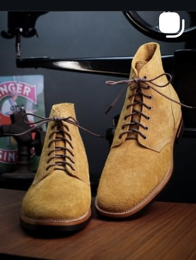](tiles/P15_s2r1c3.jpg)

- **Keluarga:** Chukka & derby
- **Arketipe:** Derby / chukka tinggi
- **Tinggi shaft:** 5 inci
- **Bahan (visual):** Suede kuning mustard dengan serat rapi dan warna rata
- **Warna:** Mustard / kuning tua
- **Sol:** Sol kulit natural tipis, outsole gelap
- **Konstruksi (terlihat):** Welt datar tipis dengan jahitan rapat
- **Detail:** 6 pasang lubang tali; Tanpa toe cap, potongan derby terbuka; Toe agak memanjang (almond); Kontras suede cerah vs sol pucat
- **Estimasi harga katalog (demo):** Rp 2.350.000
- **Tag:** suede, mustard, derby, kulit-sole
- **Catatan komersial:** Warna paling mudah viral di feed; cocok untuk kampanye seasonal.

### TB-16 — Lace-Up Ankle Greige Suede

[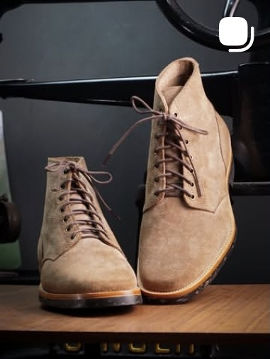](tiles/P16_s2r2c1.jpg)

- **Keluarga:** Chukka & derby
- **Arketipe:** Lace-up ankle (jodhpur hybrid)
- **Tinggi shaft:** 5,5 inci
- **Bahan (visual):** Suede greige/beige dengan texture halus
- **Warna:** Greige / beige
- **Sol:** Midsole kulit cokelat + outsole karet hitam tipis
- **Konstruksi (terlihat):** Welt datar dengan jahitan tepi terlihat
- **Detail:** 10 pasang lubang tali sampai atas; Tanpa toe cap; Bentuk shaft lurus seperti jodhpur; Sol dua lapis (kulit + karet)
- **Estimasi harga katalog (demo):** Rp 2.550.000
- **Tag:** suede, beige, lace-up, minimalis
- **Catatan komersial:** Versi 'quiet luxury' - netral, mudah dipadukan.

### TB-17 — Strap Ankle Oxblood Gloss

[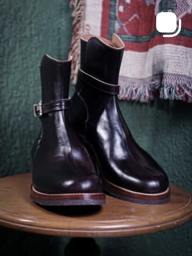](tiles/P17_s2r2c2.jpg)

- **Keluarga:** Strap & jodhpur ankle
- **Arketipe:** Strap ankle boot
- **Tinggi shaft:** 6 inci
- **Bahan (visual):** Sapi halus burgundy/oxblood dengan kilap tinggi (spit shine)
- **Warna:** Oxblood / burgundi
- **Sol:** Midsole kulit cokelat + outsole karet hitam, tumit rendah
- **Konstruksi (terlihat):** Welt datar dengan jahitan kontras di tepi midsole
- **Detail:** Satu strap pergelangan dengan buckle kuningan; Toe agak pointy, siluet ramping; Tanpa tali; Finish mengilap - beda dari TB-06 yang doff
- **Estimasi harga katalog (demo):** Rp 2.850.000
- **Tag:** strap, oxblood, gloss, almond-toe
- **Catatan komersial:** Warna oxblood selalu punya pembeli; cocok untuk edisi terbatas.

### TB-18 — Engineer Double Strap Black

[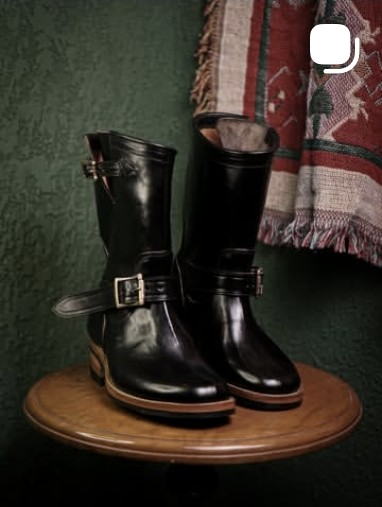](tiles/P18_s2r2c3.jpg)

- **Keluarga:** Engineer
- **Arketipe:** Engineer / harness
- **Tinggi shaft:** 8 inci
- **Bahan (visual):** Sapi hitam berkilap dengan crease lebar di punggung kaki
- **Warna:** Hitam
- **Sol:** Sol karet hitam tipis dengan tumit blok berlapis (wood-look)
- **Konstruksi (terlihat):** Welt datar; jahitan tepi sol rapi satu baris
- **Detail:** Dua strap lebar dengan buckle perak; Top line terbuka tanpa tali; Siluet biker klasik; Shaft tinggi sampai betis bawah
- **Estimasi harga katalog (demo):** Rp 3.550.000
- **Tag:** engineer, biker, double-strap, hitam
- **Catatan komersial:** Ikon biker; basis penggemar kuat dan mudah di-upsell jadi MTO.

### TB-19 — Custom Western Smiley Black

[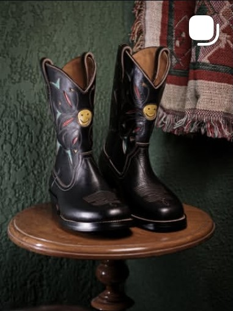](tiles/P19_s2r3c1.jpg)

- **Keluarga:** Western
- **Arketipe:** Custom western
- **Tinggi shaft:** 11 inci
- **Bahan (visual):** Sapi hitam untuk shaft dan vamp, dengan bordir warna-warni dan stud kuningan
- **Warna:** Hitam + aksen warna
- **Sol:** Sol kulit dengan tumit bertumpuk
- **Konstruksi (terlihat):** Welt datar; jahitan dekoratif warna kontras
- **Detail:** Stud kuningan berbentuk smiley di kedua shaft; Bordir floral/flame colorful; Pull hole di mulut shaft; Toe snip dengan edge dressing terang
- **Estimasi harga katalog (demo):** Rp 4.450.000
- **Tag:** custom, western, stud, bordir
- **Catatan komersial:** Satu-satunya custom art piece - bukti layanan custom design.

### TB-20 — Norwegian Welt Olive Commando

[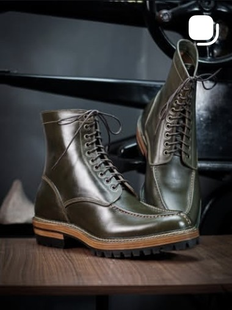](tiles/P20_s2r3c2.jpg)

- **Keluarga:** Service & hiking lace-up
- **Arketipe:** Service / hiking
- **Tinggi shaft:** 6 inci
- **Bahan (visual):** Sapi pull-up olive/military green dengan burnish di toe
- **Warna:** Olive
- **Sol:** Midsole kulit natural + outsole karet commando bergerigi dalam
- **Konstruksi (terlihat):** Jahitan welt ganda (Norwegian storm welt) terlihat jelas di tepi sol
- **Detail:** Toe cap dengan jahitan melintang; Jahitan dekoratif di panel samping; Tali kulit gelap 8 pasang; Tumit rendah dengan top piece karet
- **Estimasi harga katalog (demo):** Rp 3.650.000
- **Tag:** norwegian-welt, olive, commando, toe-cap
- **Catatan komersial:** Item paling 'craft' - tunjukkan foto makro welt untuk jualan.

### TB-21 — Hiking Lace-Up Charcoal Olive

[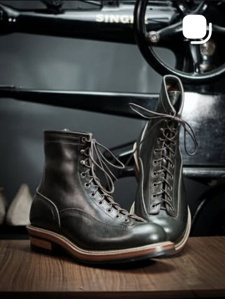](tiles/P21_s2r3c3.jpg)

- **Keluarga:** Service & hiking lace-up
- **Arketipe:** Service / hiking
- **Tinggi shaft:** 7 inci
- **Bahan (visual):** Sapi halus abu-olive gelap dengan patina
- **Warna:** Charcoal olive
- **Sol:** Midsole kulit natural + outsole karet hitam bergerigi
- **Konstruksi (terlihat):** Welt ganda dengan jahitan kontras terang
- **Detail:** Jumlah lubang tali banyak (10+); Tanpa toe cap, jahitan samping dekoratif; Siluet ramping dibanding TB-20; Sol dua warna (kulit + karet)
- **Estimasi harga katalog (demo):** Rp 3.450.000
- **Tag:** hiking, olive, welt-ganda, lace-up
- **Catatan komersial:** Alternatif lebih ringan dari TB-20 untuk pemakaian harian.

### TB-22 — Logger Tall Contrast Stitch

[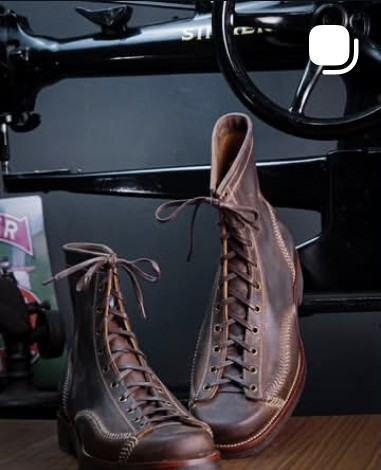](tiles/P22_s2r4c1.jpg)

- **Keluarga:** Service & hiking lace-up
- **Arketipe:** Logger / tall lace-up
- **Tinggi shaft:** 9 inci
- **Bahan (visual):** Sapi cokelat tua berminyak (oiled) dengan patina terang di toe
- **Warna:** Dark brown
- **Sol:** Wedge kulit penuh dengan outsole karet
- **Konstruksi (terlihat):** Jahitan kontras terang di sepanjang welt dan shaft
- **Detail:** Lubang tali banyak sampai atas shaft; Toe bulat dengan bumper; Jahitan dekoratif membentuk panel di punggung; Tumit wedge rendah
- **Estimasi harga katalog (demo):** Rp 3.750.000
- **Tag:** logger, tall, kontras-jahitan, wedge
- **Catatan komersial:** Item 'heritage' paling tebal; cocok untuk konten proses jahit.

### TB-23 — Mountain Boot Burgundy Padded

[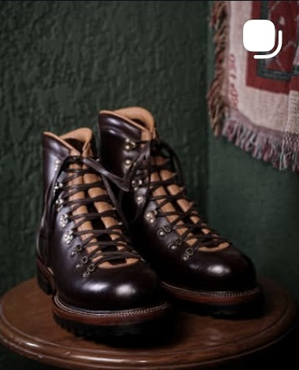](tiles/P23_s2r4c2.jpg)

- **Keluarga:** Mountain / alpine
- **Arketipe:** Mountain / alpine
- **Tinggi shaft:** 6,5 inci
- **Bahan (visual):** Sapi burgundy kemerahan berkilap; collar tan empuk
- **Warna:** Burgundy / oxblood
- **Sol:** Outsole karet hitam tebal bergerigi + welt kulit
- **Konstruksi (terlihat):** Welt kulit dengan jahitan ganda
- **Detail:** Hardware D-ring/logam di sepanjang shaft; Collar empuk warna tan; Many eyelets dengan tali kulit; Toe bulat, silhouette gemuk
- **Estimasi harga katalog (demo):** Rp 3.950.000
- **Tag:** mountain, burgundy, padded, d-ring
- **Catatan komersial:** Saudara TB-05 dalam warna berani; pakai untuk kampanye warna.

### TB-24 — Engineer Buckle Black (mid-calf)

[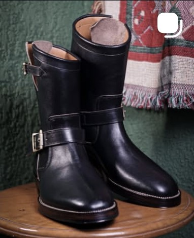](tiles/P24_s2r4c3.jpg)

- **Keluarga:** Engineer
- **Arketipe:** Engineer / harness
- **Tinggi shaft:** 8,5 inci
- **Bahan (visual):** Sapi hitam berkilap dengan crease dalam
- **Warna:** Hitam
- **Sol:** Sol karet hitam dengan tepi midsole terang (kontras)
- **Konstruksi (terlihat):** Welt datar; jahitan midsole terang terlihat jelas
- **Detail:** Dua strap lebar dengan buckle metal di sisi luar; Mulut shaft dilipat (cuff) dengan lining terang; Jahitan welt kontras terang di tepi sol; Tumit blok rendah dengan top piece karet
- **Estimasi harga katalog (demo):** Rp 3.650.000
- **Tag:** engineer, buckle, hitam, mid-calf
- **Catatan komersial:** Versi lebih 'dressy' dari TB-18 - lining terang jadi nilai jual.

---

## Kamus spesifikasi resmi (dari caption akun)

Istilah di bawah ini diambil **verbatim** dari caption postingan terbaru
`@tahurabootsco` yang bisa dibaca lewat cermin publik. Pakai istilah ini
saat menulis deskripsi produk supaya konsisten dengan bahasa studio.

**Konstruksi yang dipakai:**

- *Flat Hand welt 270 degree*; *Flat welt with chain stitch 270 degree*
- *Norwegian split storm welt 360 degree* (chain stitch)
- *Norwegian construction with traditional method, chain stitch, two tone thread*

**Sol dan tumit:**

- Vibram 700 (full sole), Vibram Komando 1100, Vibram half sole *Explosion*
- Dr. Sole Supergrip II (half/full), Dr. Sole black cord, Dr. Sole redbrown cork
- *Brazilian vegetable leather midsole*
- Gaya tumit: *Cuban heels*, *Woodsman heels*

**Bahan:**

- Horsebutt dari Maryam Tannery Italia (olive, black, natural hand-dyed burgundy)
- Javan cowhide: rough out tan, rough out camel, olive pull-up, black teacore pull-up
- *Full lining lambskin*

**Kode model yang muncul di caption:** BDK 026, CWB 026, CWB custom design,
Gaharu 3.0 9 inch, GAHARU JP.26, Benjamina 3, Merkusi, Captoelari.

**Kontak resmi di caption:** WA 0822-4436-3343, tahurabootscompany@gmail.com,
bio: *Bandung boots maker — DM for more information — we ship worldwide*.

### Contoh caption asli (utuh)

```
[MTO RESULT]. Ready to shipp.
— Merkusi —
• Olive javan pullup cowhide
• Full lining lambskin.
• Norwegian split stormwelt with chain stitch construction 360 degree
• Vegetable brazilian leather midsole.
• Black full sole komando 1100 @vibram
```

Pola caption mereka selalu: status (MTO/ready) → nama model → bahan →
lining → konstruksi → midsole → sol → kontak. Katalog di atas dibuat
mengikuti urutan itu agar mudah dipakai ulang.

---

## Yang perlu kamu tambahkan

Kalau mau katalog ini jadi materi jualan penuh, tiga hal ini masih kurang
dan tidak bisa diambil dari sandbox:

1. **Foto resolusi penuh** (1080 px+). Potongan grid di sini 381 px, cukup
   untuk referensi dan thumbnail, tapi belum layak jadi foto produk utama.
   Buka tiap postingan di app → titik tiga → *Save*, atau minta ekspor data
   Instagram (Settings → Your activity → Download your information).
2. **Caption dan tanggal per postingan.** Tempel ke `catalog.json` di field
   baru (`caption`, `postedAt`, `permalink`) - skrip `build.py` akan ikut
   menampilkannya di Markdown dan galeri.
3. **Harga resmi + status stok.** Angka `priceIdr` di sini adalah estimasi
   demo berdasarkan band harga seed katalog, bukan harga studio.
